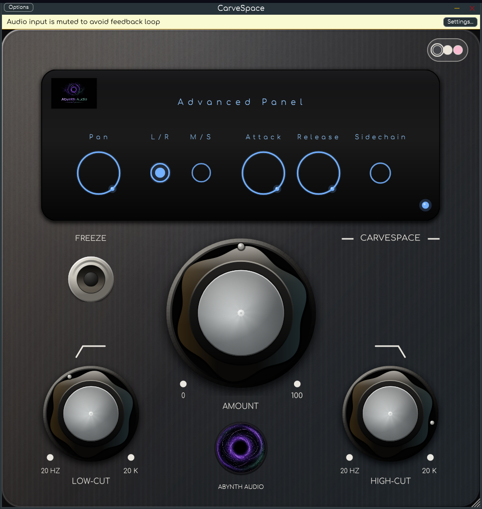

<p align="center">
  
</p>

<h1 align="center">CarveSpace</h1>

<p align="center">
  <b>32-band spectral sidechain carver — native VST3 for Linux, Windows and macOS&nbsp;(Apple&nbsp;Silicon)</b><br>
  Zero latency. Dark, Light and pastel-Pink skins. Free and open source, no authorization.
</p>

<p align="center">
  <a href="https://github.com/AbynthAudio/CarveSpace/releases/latest"></a>
  <a href="LICENSE"></a>
  
</p>

---

## Why I built this

I wanted a native VST3 that does the spectral-sidechain-carving trick on Linux, without Wine and without a dongle. So I wrote one.

CarveSpace analyses the spectrum of a trigger signal (the *sidechain*) and applies the inverse EQ curve to the track it is inserted on, so two elements can share the same frequency range without fighting. Put it on a bass, a pad, a vocal or a full bus, feed it a sidechain, and turn up **Amount** — the 32-band dynamic EQ does the work in real time.

> **This is my own independent work.** I wrote all the code, the DSP and the UI drawing from scratch. CarveSpace is inspired by the workflow of Wavesfactory **Trackspacer 2.5**, but it is **not affiliated with, endorsed by or connected to Wavesfactory**, and it contains no Wavesfactory code, binaries, images or fonts. *Trackspacer* is a trademark of its respective owner. I studied the original's behaviour only to keep the controls familiar and interoperable.

## Features

- **32-band dynamic EQ** driven by an external stereo sidechain.
- **Zero added latency** — measured sample-exact.
- **Amount** (depth), **Low-cut / High-cut** filters, **Attack / Release** ballistics.
- **L/R and M/S** processing with a continuous **Pan** of the effect.
- **Freeze** (hold the current reduction curve) and **Sidechain Audition**.
- **Spectrum display** with the sidechain spectrum and the applied reduction curve, plus a hover read-out.
- **Resizable** 650×650 editor; size and skin are remembered per project.
- **Three skins**: Dark, Light and pastel **Pink**.
- **Animated Abynth Audio swirl**: it rotates slowly; click it to pause or resume.
- **No licensing, serial, iLok or authorization** — GPLv3 open source.

## Screenshots

**The three skins.**

<p align="center">
  
</p>

<p align="center">
  
  
  
</p>

**The advanced panel** (Pan, L/R–M/S, Attack, Release, Sidechain audition):

<p align="center">
  
</p>

The Abynth Audio swirl rotates in the background; **click it to pause or resume** the animation.

## Download

Grab the latest release:

**[⬇ Downloads — GitHub Releases](https://github.com/AbynthAudio/CarveSpace/releases/latest)**

| Platform | File | Notes |
|---|---|---|
| **Linux x86_64** | `CarveSpace-linux-x86_64.vst3.tar.gz` | VST3 only |
| **Windows x64** | `CarveSpace-windows-x64.vst3` | Direct VST3 file — **untested** (cross-built on Linux) |
| **macOS Apple Silicon** | `CarveSpace-macos-arm64.vst3.tar.gz` | VST3 only, unsigned — **untested** (built by CI, not run on macOS hardware) |

### Install

**Linux**

```bash
tar -xzf CarveSpace-linux-x86_64.vst3.tar.gz
mkdir -p ~/.vst3
cp -r CarveSpace.vst3 ~/.vst3/
```

**Windows** — copy `CarveSpace-windows-x64.vst3` directly to `C:\Program Files\Common Files\VST3\`.

**macOS** — extract the `.tar.gz` and copy `CarveSpace.vst3` to `~/Library/Audio/Plug-Ins/VST3/` (or `/Library/Audio/Plug-Ins/VST3/`); if Gatekeeper complains, right-click → Open.

I develop and test on Linux, so the Windows and macOS builds are provided as-is and have not been tested on those systems. If something does not work there, please open an issue.

## Quick start

1. Insert CarveSpace on the track that should make room (bass, pads, bus…).
2. Enable the sidechain input in your DAW and route the priority track (kick, vocal…) into it.
3. Raise **Amount** until the track sits in the mix.
4. Fine-tune with **Low-cut / High-cut**; open the advanced panel (the dot in the display) for **Pan**, **L/R–M/S**, **Attack**, **Release** and **Sidechain Audition**.

## Parameters

| # | Name (UI) | ID | Range | Default |
|---|-----------|----|-------|---------|
| 0 | Amount (`Ratio`) | `RATIO` | 0–100 % | 15 % |
| 1 | Low-cut | `LC` | 20 Hz–20 kHz (log) | 20 Hz |
| 2 | High-cut | `HC` | 20 Hz–20 kHz (log) | 20 kHz |
| 3 | Freeze | `FREEZE` | on/off | off |
| 4 | Pan | `PAN` | 0–100 | 50 |
| 5 | Stereo Mode | `MODE` | L/R, M/S | L/R |
| 6 | Attack | `AT` | 0.01–100 ms (log) | 5 ms |
| 7 | Release | `RL` | 1–700 ms (log) | 30 ms |
| 8 | Sidechain audition | `SIDECHAIN` | on/off | off |
| 9 | Bypass | *(VST3 auto)* | on/off | off |

Stereo input, stereo output and a stereo sidechain input bus. If no sidechain is connected, CarveSpace analyses its own input.

## Build from source

JUCE 7.0.5 is not vendored (it is large). Clone it into `JUCE/` first:

```bash
git clone https://github.com/AbynthAudio/CarveSpace.git
cd CarveSpace
git clone --depth 1 --branch 7.0.5 https://github.com/juce-framework/JUCE.git JUCE
cmake -B build -G Ninja -DCMAKE_BUILD_TYPE=Release
ninja -C build CarveSpace_VST3
```

Output: `build/CarveSpace_artefacts/Release/VST3/CarveSpace.vst3`.

Cross-compiling Windows with LLVM-MinGW and macOS CI notes are in [docs/BUILD.md](docs/BUILD.md) and [docs/BUILD-CROSS.md](docs/BUILD-CROSS.md). The GitHub Actions matrix builds Linux, Windows and macOS arm64 automatically (see [`.github/workflows/build.yml`](.github/workflows/build.yml)).

## Project layout

```
src/            plug-in processor, zero-latency 32-band DSP, editor and GUI
assets/         Abynth Audio logo/icon/wordmark + Comfortaa font
docs/           build docs, spec, screenshots and the skins animation
tests/          offline validation harness and report
tools/host/     offline VST3 host (dump/render/screenshot tooling)
.github/        CI matrix for Linux, Windows and macOS arm64
```

## License

**GNU GPLv3** — see [LICENSE](LICENSE). Built with [JUCE 7.0.5](https://juce.com) (GPL-compatible). Comfortaa is licensed under the SIL Open Font License.

<p align="center"><b>Made by Abynth Audio.</b></p>
