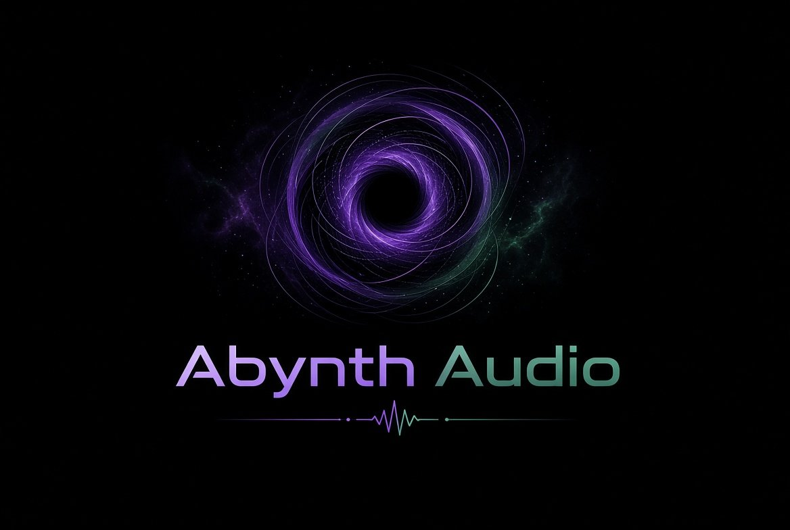
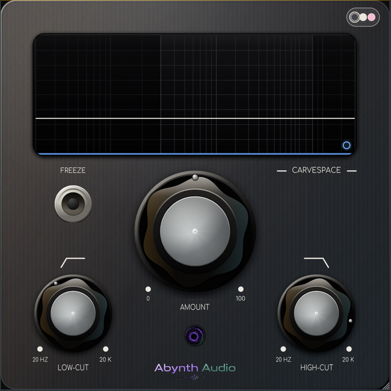
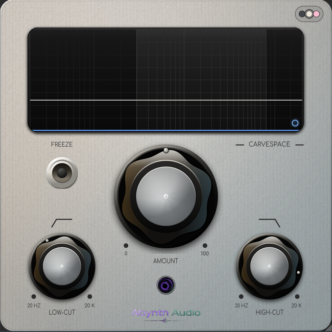
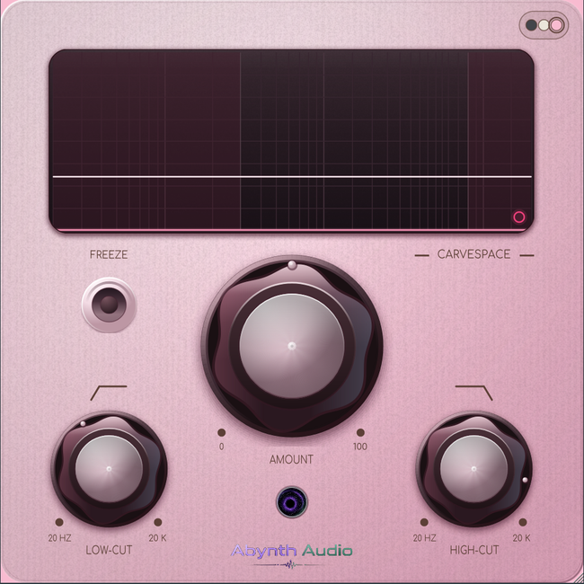

# CarveSpace

<p align="center">
  
</p>

A **native Linux VST3** spectral sidechain carver: it analyses the spectrum of a
sidechain (trigger) signal and applies the inverse curve to the track it is
inserted on, in real time, so two tracks can share the same frequency space
without fighting.

CarveSpace is an independent, from-scratch reimplementation inspired by the
workflow of Wavesfactory Trackspacer 2.5. It is not affiliated with, endorsed by
or derived from Wavesfactory code or artwork.

## Features

- 32-band dynamic EQ driven by an external sidechain input.
- Zero added latency.
- Amount / Low-cut / High-cut controls, attack and release ballistics.
- L/R or M/S processing with a pan control for the effect.
- Freeze (hold the current reduction curve).
- Sidechain audition (listen to the filtered sidechain).
- Spectrum display with sidechain spectrum, applied reduction curve and
  interactive frequency/level read-out.
- Resizable, retina-friendly 650×650 UI with Dark / Light / Pink skins
  (remembered across projects).
- Sidechain input bus (stereo or mono); falls back to the track input when no
  sidechain is connected.

## Formats

- VST3 for Linux x86_64 (local build)
- VST3 for Windows x64 (cross-built, and via CI)
- VST3 for macOS Apple Silicon arm64 (built by GitHub Actions on a macOS runner)
- Standalone (for testing)

The GitHub Actions matrix builds all three platforms; see `docs/BUILD.md`.
macOS builds are unsigned/non-notarised (right-click → Open if Gatekeeper
complains).

## Build

Requirements: CMake ≥ 3.22, Ninja, a C++17 compiler, and the usual JUCE Linux
dependencies (X11, freetype, fontconfig, ALSA, GTK3, WebKit2GTK is not required).

JUCE is not vendored in the repository (it is 80+ MB). Clone JUCE 7.0.5 into
`JUCE/` first:

```bash
git clone <this repo> CarveSpace
cd CarveSpace
git clone --depth 1 --branch 7.0.5 https://github.com/juce-framework/JUCE.git JUCE
cmake -B build -G Ninja -DCMAKE_BUILD_TYPE=Release
ninja -C build CarveSpace_VST3 CarveSpace_Standalone
```

The VST3 bundle is written to:

```
build/CarveSpace_artefacts/Release/VST3/CarveSpace.vst3
```

Install it by copying the bundle to `~/.vst3/`:

```bash
mkdir -p ~/.vst3
cp -r build/CarveSpace_artefacts/Release/VST3/CarveSpace.vst3 ~/.vst3/
```

JUCE 7.0.5 is vendored in `JUCE/` (see its license). If the directory is
missing, run `git submodule update --init --recursive` or clone JUCE 7.0.5 into
`JUCE/`.

## Screenshots

| Dark | Light | Pink |
|------|-------|------|
|  |  |  |

Advanced panel: [advanced-650.png](docs/screenshots/advanced-650.png).

## Themes

The editor has three skins — **Dark**, **Light** and **Pink** (pastel) — selected
with the visible skin button in the top-right corner of the faceplate. The
chosen theme and the editor size are saved with the project and also remembered
in `~/.config/AbynthAudio/CarveSpace.conf`.

## Usage

1. Insert CarveSpace on the track that should make room (e.g. bass or pads).
2. Enable the plugin's sidechain input and route the priority track
   (e.g. kick or vocal) to it.
3. Raise **Amount** until the track sits in the mix.
4. Fine-tune with **Low-cut** / **High-cut**, and use the advanced panel for
   **Pan**, **L/R–M/S**, **Attack**, **Release**, **Freeze** and
   **Sidechain audition**.

If the host does not provide a sidechain, CarveSpace analyses its own input
(internal sidechain), matching the fallback behaviour of the original.

## Notes on JUCE licensing

This project is built with JUCE 7.0.5 and is distributed under the **GNU GPL
v3** (see `LICENSE`). If you need other licensing terms, obtain a JUCE license
and relicense accordingly.

## Disclaimer

Trackspacer is a trademark of Wavesfactory. CarveSpace is an independent
compatibility reimplementation for Linux, created for interoperability and
research; no Wavesfactory binaries, code, images or fonts are included.
