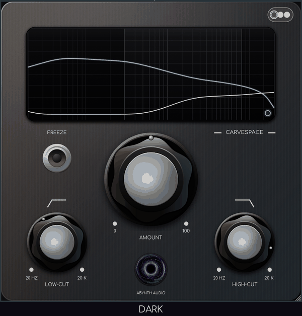
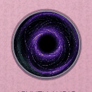

# CarveSpace 1.0.0

  

  

First public release of **CarveSpace**, the 32-band spectral sidechain carver by **Abynth Audio**.

## Downloads

| Platform | Asset |
|---|---|
| Linux x86_64 | `CarveSpace-linux-x86_64.zip` (VST3 + Standalone) |
| Windows x64 | `CarveSpace-windows-x64.zip` (VST3 + Standalone) — **untested** (cross-built on Linux) |
| macOS Apple Silicon | `CarveSpace-macos-arm64.zip` (VST3, unsigned) — **untested** (CI-built, not run on macOS hardware) |

## Highlights

- Zero-latency 32-band dynamic EQ driven by a stereo external sidechain.
- Amount, Low-cut, High-cut, Attack, Release, Pan, L/R–M/S, Freeze and Sidechain Audition.
- Spectrum display with sidechain spectrum and applied reduction curve.
- Three skins (Dark / Light / pastel Pink), persisted per project, plus persisted editor size.
- Animated Abynth Audio swirl; click it to pause/resume.
- Resizable 650×650 editor, no authorization, no telemetry, GPLv3.

## Notes

- Windows and macOS builds are provided **untested**: development and testing happen on Linux; the Windows DLL is cross-compiled with LLVM-MinGW and the macOS bundle is built by GitHub Actions but has not been run on Windows/macOS hardware. Please report issues.
- macOS build is unsigned/not notarised: right-click → Open on first launch if Gatekeeper complains.
- The plug-in is an independent reimplementation inspired by the Trackspacer workflow; it contains no Wavesfactory code, binaries, artwork or fonts and is not affiliated with Wavesfactory.
- Built with JUCE 7.0.5. Comfortaa font under the SIL Open Font License.
